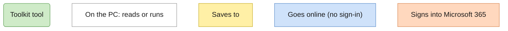
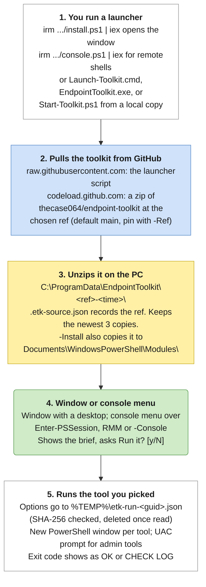
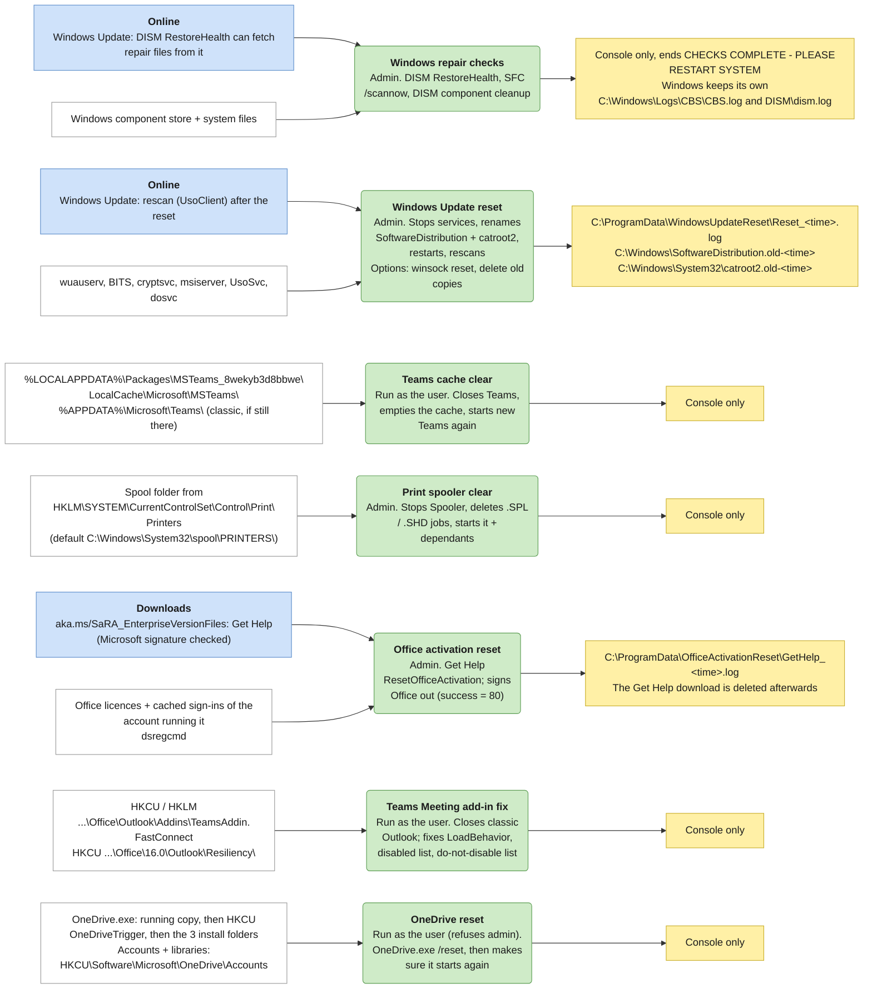
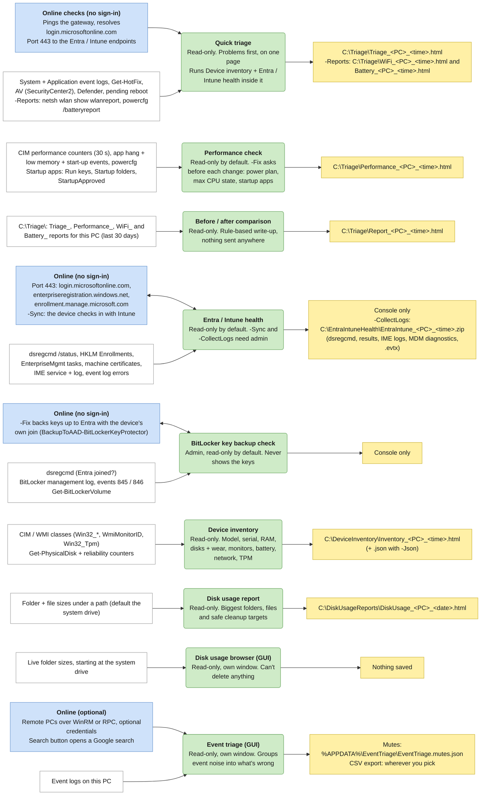
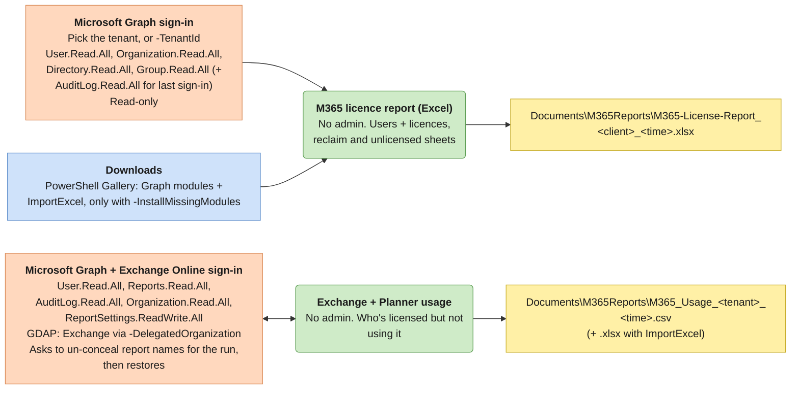

# Data flow: where everything goes

Reports save to the PC. Only three tools sign into Microsoft 365: Intune primary user (also run by New device setup), M365 licence report, and Exchange + Planner usage.

For each tool, this page shows where it gets information or signs in, what it runs, and where it saves. It's written from the scripts as of v1.10.1. If a tool's paths, downloads or sign-ins change, update this page in the same commit.

Arrows point the way information flows. A two-way arrow means the tool also changes something there: Intune primary user sets the device's primary user in the tenant, Exchange + Planner usage can un-conceal report names for the run (and puts them back), Entra / Intune health `-Sync` makes the device check in with Intune, and BitLocker `-Fix` backs keys up to Entra.

## Contents

- [Starting the toolkit](#starting-the-toolkit)
- [Build](#build)
- [Repair](#repair)
- [Diagnose](#diagnose)
- [Report (Microsoft 365 tenant)](#report-microsoft-365-tenant)
- [Every folder it writes to on the PC](#every-folder-it-writes-to-on-the-pc)

## Starting the toolkit

## Build

```mermaid
%%{init: {"flowchart": {"wrappingWidth": 400}}}%%
flowchart LR
    classDef tool fill:#CFEBC8,stroke:#5E9E55,color:#1b1b1b
    classDef local fill:#FFFFFF,stroke:#9A9A9A,color:#1b1b1b
    classDef out fill:#FFF0A6,stroke:#C9AF2E,color:#1b1b1b
    classDef net fill:#CFE2FA,stroke:#5F8FCB,color:#1b1b1b
    classDef auth fill:#FFD8BE,stroke:#D98A57,color:#1b1b1b
    B1T("<b>New device setup</b><br/>Admin. Runs in order: primary<br/>user, McAfee, debloat, M365,<br/>Chrome + Reader, Dell / HP /<br/>Lenovo drivers<br/>Then restarts in 60 s (shutdown /a<br/>cancels)"):::tool
    B1A["<b>Microsoft Graph sign-in</b><br/>Only if a primary user is given (the Intune<br/>primary user step)"]:::auth <--> B1T
    B1N["<b>Online</b><br/>Whatever each step downloads (see those tools)<br/>Windows Update scan for the report (COM, 15<br/>min limit)"]:::net --> B1T
    B1L["Ticket, technician, primary user (asked at the<br/>start)<br/>tools.json briefs#59; device + app details (CIM,<br/>registry, dsregcmd)#59; pending restart"]:::local --> B1T
    B1T --> B1O["C:\ProgramData\DeploymentMaster\Reports\<br/>BuildReport_#lt;PC#gt;_#lt;time#gt;.html + .json (opens at<br/>the end)<br/>C:\ProgramData\DeploymentMaster\Logs\<br/>MasterDeploy_#lt;time#gt;.log and Build_#lt;time#gt;\ (step<br/>output)<br/>Plus each step's own log folder. Deletes the<br/>_modules cache."]:::out
    B2T("<b>McAfee removal</b><br/>Admin. Remove-AppxPackage, msiexec<br/>/x, McAfee's own uninstallers<br/>Exit 3010 = removed, restart"):::tool
    B2L["McAfee Store apps (all users)<br/>HKLM Uninstall keys (32 + 64-bit)<br/>WebAdvisor uninstaller in Program Files"]:::local --> B2T
    B2T --> B2O["C:\ProgramData\McAfeeRemoval\McAfeeRemoval_<br/>#lt;date#gt;.log<br/>Only links to MCPR for stubborn suites#59;<br/>downloads nothing"]:::out
    B3T("<b>OEM debloat (HP / Dell)</b><br/>Admin. Removes OEM + consumer<br/>apps, keeps SupportAssist / HP<br/>Support Assistant<br/>Menu default: dry run"):::tool
    B3L["Store + provisioned apps<br/>Uninstall keys (HKLM + HKCU)<br/>Writes settings to the Default user hive<br/>(NTUSER.DAT) and loaded user hives"]:::local --> B3T
    B3T --> B3O["C:\ProgramData\Debloat\debloat-#lt;time#gt;.log"]:::out
    B4T("<b>OEM drivers + BIOS</b><br/>Admin. Scans, lists, asks,<br/>installs drivers + firmware (BIOS<br/>only if ticked)<br/>Never restarts"):::tool
    B4N["<b>Downloads (asks first)</b><br/>winget: Dell.CommandUpdate.Universal,<br/>HP.ImageAssistant<br/>PowerShell Gallery: LSUClient (+ NuGet)<br/>Then the vendor's own update catalogue"]:::net --> B4T
    B4L["Make from Win32_ComputerSystem<br/>Dell: Program<br/>Files\Dell\CommandUpdate\dcu-cli.exe<br/>HP: C:\SWSetup\...\HPImageAssistant.exe"]:::local --> B4T
    B4T --> B4O["C:\ProgramData\OEMUpdates\#lt;Vendor#gt;_#lt;time#gt;.log +<br/>report folder<br/>Dell:<br/>C:\ProgramData\Dell\OEMUpdates\Dell_#lt;time#gt;\<br/>(copied back)"]:::out
    B5T("<b>M365 Apps reset + reinstall</b><br/>Admin. ODT Remove All, optional<br/>Get Help scrub (-DeepClean), then<br/>a clean install"):::tool
    B5N["<b>Downloads</b><br/>officecdn.microsoft.com: ODT setup.exe<br/>(signature checked) + the 3-4 GB install<br/>aka.ms/SaRA_EnterpriseVersionFiles: Get Help,<br/>-DeepClean only (Microsoft signature checked)"]:::net --> B5T
    B5L["Every installed Office, MSI Office included"]:::local --> B5T
    B5T --> B5O["C:\OfficeReset\OfficeReset_#lt;time#gt;.log<br/>(transcript)<br/>setup.exe, remove.xml, install.xml<br/>GetHelp_#lt;time#gt;.log (-DeepClean)"]:::out
    B6T("<b>Chrome + Adobe Reader</b><br/>Admin. Silent installs#59; locks down<br/>Reader cloud / AI features<br/>(HKLM\SOFTWARE\Policies\Adobe)"):::tool
    B6N["<b>Downloads</b><br/>dl.google.com: Chrome Enterprise MSI (must be<br/>signed Google LLC)<br/>rdc.adobe.io: latest Reader version<br/>ardownload2.adobe.com: Reader installer (must<br/>be signed Adobe Inc.)"]:::net --> B6T
    B6L["Installed apps (HKLM Uninstall keys)"]:::local --> B6T
    B6T --> B6O["Downloads land in %TEMP%\AppDeploy\<br/>C:\ProgramData\AppDeploy\Logs\<br/>Install-ChromeAndReader_#lt;time#gt;.log +<br/>Chrome_msi.log"]:::out
    B7T("<b>Intune primary user</b><br/>No admin needed. Shows, sets or<br/>removes the primary user#59; Intune<br/>updates the Entra owner"):::tool
    B7A["<b>Microsoft Graph sign-in as a tenant admin</b><br/>Sign-in window#59; device code with no desktop<br/>DeviceManagementManagedDevices.ReadWrite.All<br/>(Read.All when only showing) + User.Read.All<br/>Reads + changes the device's users in Intune<br/>(Graph beta)"]:::auth <--> B7T
    B7N["<b>Downloads</b><br/>PowerShell Gallery:<br/>Microsoft.Graph.Authentication, only if<br/>missing (signature checked)"]:::net --> B7T
    B7L["Tenant ID from dsregcmd /status<br/>Intune device ID from<br/>HKLM\SOFTWARE\Microsoft\Enrollments"]:::local --> B7T
    B7T --> B7O["Console only<br/>Module cache:<br/>C:\ProgramData\EndpointToolkit\_modules (admin)<br/>or %LOCALAPPDATA%\EndpointToolkit\_modules"]:::out
    B8T("<b>Driver export</b><br/>Admin, read-only. Backs up<br/>third-party drivers before a wipe"):::tool
    B8L["Drivers in the running Windows<br/>(Export-WindowsDriver, falls back to pnputil<br/>/export-driver) or an offline image"]:::local --> B8T
    B8T --> B8O["C:\DriverExport\#lt;PC#gt;_#lt;Make#gt;_#lt;Model#gt;_#lt;date#gt;\<br/>drivers.csv, device.json, RESTORE.txt<br/>+ a .zip (menu default)"]:::out
    B9T("<b>Driver import</b><br/>Admin. pnputil /add-driver *.inf<br/>/subdirs /install"):::tool
    B9L["An export folder or .zip<br/>A .zip is unpacked to<br/>%TEMP%\DriverImport_#lt;time#gt;\"]:::local --> B9T
    B9T --> B9O["Console only<br/>Drivers go into Windows' driver store"]:::out
```

## Repair

## Diagnose

## Report (Microsoft 365 tenant)

## Every folder it writes to on the PC

`<PC>` is the computer name and `<time>` a timestamp. Folders are created on first use.

| Folder | Written by |
|---|---|
| `C:\ProgramData\EndpointToolkit\` | Launcher (toolkit copies), Intune primary user (_modules) |
| `C:\ProgramData\DeploymentMaster\` | New device setup (Reports, Logs) |
| `C:\ProgramData\McAfeeRemoval\` | McAfee removal |
| `C:\ProgramData\Debloat\` | OEM debloat |
| `C:\ProgramData\OEMUpdates\ + Dell\OEMUpdates\` | OEM drivers + BIOS |
| `C:\ProgramData\AppDeploy\Logs\` | Chrome + Adobe Reader |
| `C:\ProgramData\OfficeActivationReset\` | Office activation reset |
| `C:\ProgramData\WindowsUpdateReset\` | Windows Update reset |
| `C:\OfficeReset\` | M365 Apps reset + reinstall |
| `C:\Triage\` | Quick triage, Performance check, Before / after comparison |
| `C:\DeviceInventory\` | Device inventory |
| `C:\DiskUsageReports\` | Disk usage report |
| `C:\DriverExport\` | Driver export |
| `C:\EntraIntuneHealth\` | Entra / Intune health (-CollectLogs) |
| `Documents\M365Reports\` | M365 licence report, Exchange + Planner usage |
| `%APPDATA%\EventTriage\` | Event triage (mutes) |
| `%TEMP%` | Window run options, Chrome + Reader downloads, Driver import unzip |
| Console only (no file: keep a transcript) | Intune primary user, Windows repair, Teams cache, Print spooler, Teams add-in fix, OneDrive reset, BitLocker check, Driver import |

`Documents` is the Documents folder of the account running the tool, which follows OneDrive redirection.
